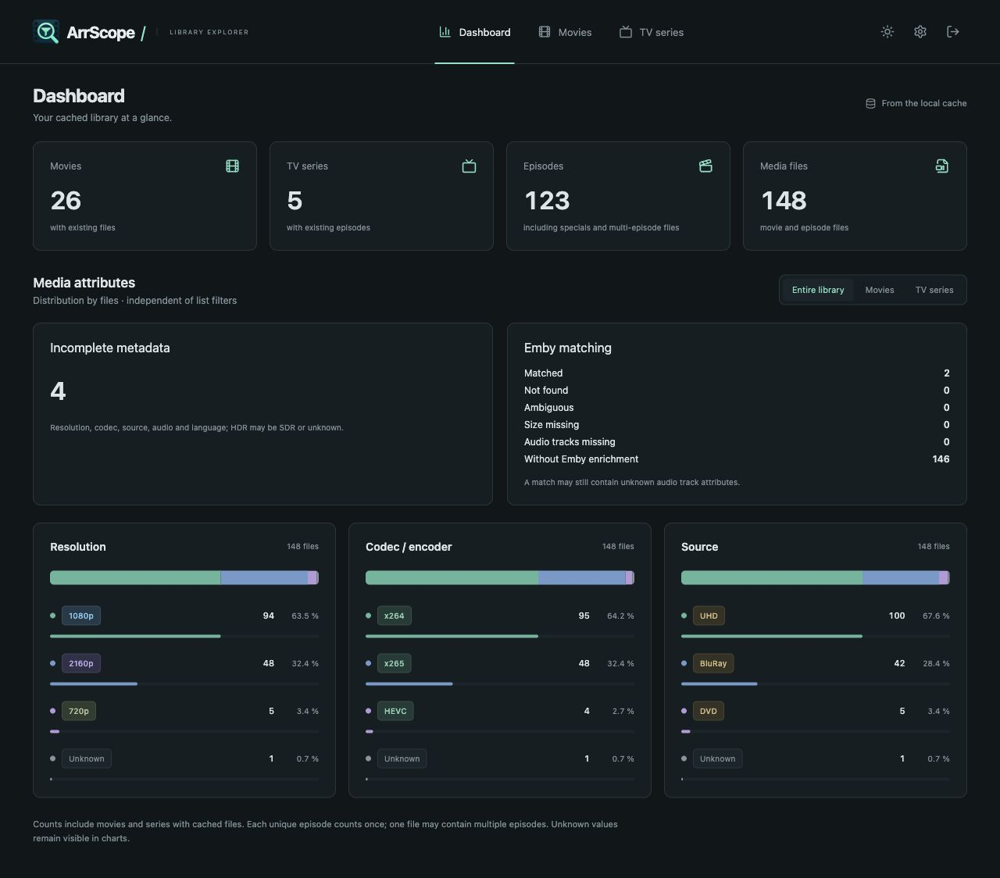
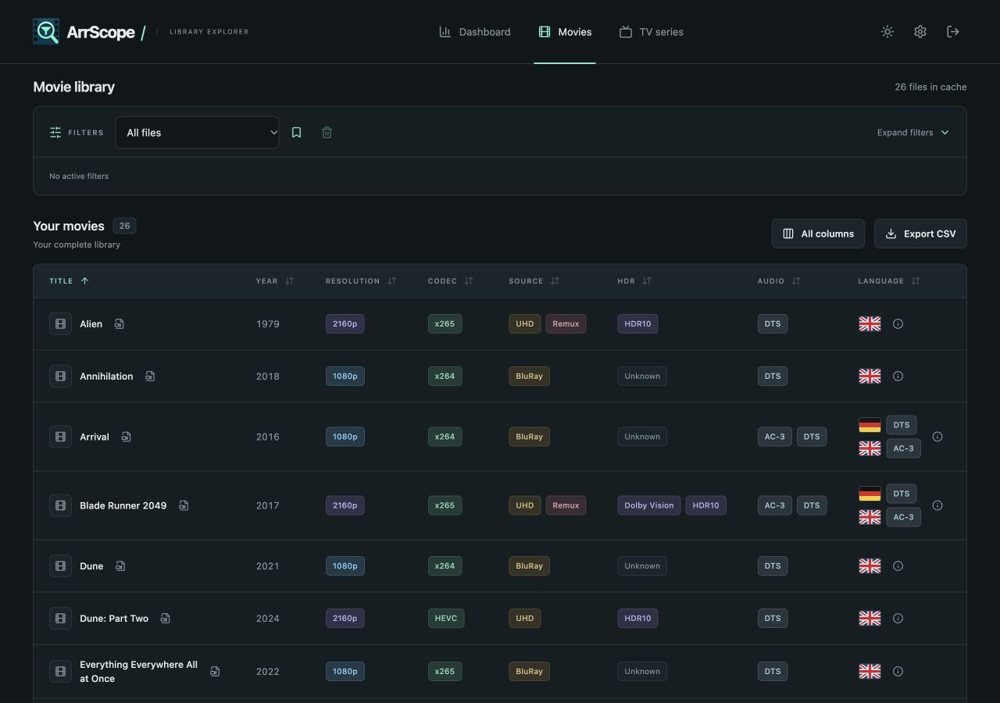

# ArrScope

Explore and filter your Radarr and Sonarr libraries using existing filenames and API metadata. A lightweight, self-hosted web app with a local SQLite cache — no media scans, media mounts or external database server.





Screenshots use isolated synthetic data with BluRay, DVD and UHD source labels. Real metadata detection remains unchanged.

## Features

- Separate movie and TV libraries, a default dashboard, responsive layouts, dark and light themes.
- English, German, Spanish and Italian interfaces, with a browser-specific language preference and straightforward [translation contributions](docs/TRANSLATING.md).
- Filename-first resolution, codec/encoder and source detection, supplemented by existing API metadata. Inspect provenance and conflicting values in each file’s details.
- Combined resolution, codec family, source, processing, year, size, HDR, bit depth, audio codec, channels and audio language filters. Search titles and filenames; select unknown and incomplete metadata.
- Include/exclude filters and “contains all” / “does not contain all” for audio, HDR and language. Saved presets and CSV use the same filter logic.
- Grouped TV seasons, specials and multi-episode files. Show only matching files or complete matching seasons with highlighted matches.
- Dashboard counts and distributions by resolution, codec and source. Click a tag to select its value in the existing library filters. Selections remain unsaved unless you explicitly save a preset.
- Optional Emby enrichment reads already available audio tracks. Local SVG language flags have translated tooltips and remain associated with each track’s codec. Multiple audio codecs and HDR profiles use separate tags.
- Persistent configurable columns, column order, tag backgrounds and black/white/automatic text colors. Temporary “All columns” view; clickable movie headers for sorting.
- Indexed SQLite queries and FTS5 search, atomic sync snapshots, cached dashboard aggregates and a global sync queue.
- One local admin account, encrypted API keys, HttpOnly sessions, CSRF protection and limited login attempts.
- A single Go process and embedded Preact frontend; AMD64 and ARM64 Docker images.

## Install

See [Unraid installation](docs/UNRAID.md). For other Docker hosts:

```sh
cp .env.example .env
# Set ARRSCOPE_APPDATA, ARRSCOPE_PORT and UID/GID in .env.
mkdir -p /local/pool/appdata/arrscope
sudo chown 99:100 /local/pool/appdata/arrscope
sudo chmod 700 /local/pool/appdata/arrscope
docker compose pull
docker compose up -d
```

Adapt the local path and UID/GID to your host. The public image is `ghcr.io/buffer379x/arrscope:stable`. Open port 8080, obtain the one-time setup code with `docker exec arrscope cat /data/setup-token`, and enter it with your new credentials directly in the web interface. Under Settings → Services, enter the service URLs and API keys, test, enable and save. The initial sync starts automatically.

Connect exactly one instance per service. URL subpaths are supported, for example `http://radarr:7878/radarr`; do not append `/api/v3` or put credentials/query parameters in the URL. TLS certificates are verified and redirects are rejected. Sync intervals: manual only, 15, 30, 60 (default), 360 or 1440 minutes. Emby follows the corresponding Radarr/Sonarr sync.

## Filters and metadata

Different fields use AND; multiple values of one ordinary field use OR. For example, choose `1080p`, `x265`, and Source **is not** `BluRay` and `WEB-DL`. None of the excluded sources may occur. Unknown values remain included unless explicitly excluded.

Audio, HDR and language also support **contains all** and **does not contain all**. With HDR10 and Dolby Vision selected, “does not contain all” finds files missing at least one **reported attribute**; it does not prove physical absence in a file. Generic HDR does not imply HDR10, and Dolby Vision alone does not imply an HDR10 fallback. `4K` maps to `2160p`; `x264` remains distinct from `AVC` while both share the `H.264/AVC` family.

Movie titles and years come from Radarr. Episode titles, seasons and first-air years come from Sonarr. One file containing multiple episodes appears once. A dashboard movie count refers to distinct movies, so it may differ from the movie file count. The default page size is 100; CSV exports every actual match, excluding extra season context.

Emby uses exact basename plus identical positive byte size and requires a unique match on both sides. Optional path mappings add a full-path check. Matching respects MediaSources for multiple versions. External audio and subtitle streams are excluded. Missing or ambiguous identity is shown rather than guessed. Without Emby, multiple filename tokens can be recognized, but a reliable language-to-codec mapping is unavailable. The Channels column retains filename/Arr metadata; file details show each Emby track’s own channels.

Flags are representative language symbols, not claims about a file’s country or dialect. English uses the UK flag; an unrecognized language uses a neutral icon and its original label. Text-based filters retain original stored values across interface languages.

## Storage and security

Mount only `/data` on a local SSD/pool filesystem; SQLite WAL must not be placed on SMB/NFS. Back up the entire Appdata directory including `secret.key`. Database backups alone cannot restore encrypted keys without the matching local key. The last three consistent database snapshots are retained; migrations create a backup first. See [operations and rollback](docs/OPERATIONS.md).

ArrScope reads allowlisted API-v3 endpoints using GET: `system/status`, `movie`, `moviefile`, `series`, `episode`, `episodefile`. Emby reads `System/Info` and paginated `Items` using `X-Emby-Token`. No scan, playback, probe, download, rename or other upstream write requests are made. Independent tasks performed by those services remain outside ArrScope’s control.

Designed for LAN/VPN use. If using an HTTPS reverse proxy, set `ARRSCOPE_HTTPS=true` for Secure session cookies. Arbitrary forwarded headers are not trusted; login limiting behind a proxy applies to the proxy address. A failed or inconsistent sync keeps the previous complete cache. Upstream requests cannot provide a single transactional snapshot across a changing remote library.

## Filename recognition

Manage rules in **Settings → Filename recognition**. Preview a draft before saving. Direct rules, missing-value fallbacks and explicit overrides run by priority; contradictory recognition and metadata disagreements have separate warning icons and colors. Saving reprocesses the existing cache atomically without scans or upstream requests. See [recognition guide](docs/RECOGNITION.md).

The **Audio** column combines verified Emby language/codec pairs. Without track attribution, languages and codecs remain separate. Language and audio-codec filters keep their original semantics. Dashboard language distribution counts each movie and episode once per language and supports clickable temporary filters.

## Development

Use the Go version in `go.mod`, Node 24 and pnpm 11.25.0:

```sh
pnpm --dir web install --frozen-lockfile
node scripts/check-version.mjs
pnpm --dir web test
pnpm --dir web build
pnpm --dir web audit --audit-level=moderate
go test -race ./...
go vet ./...
go build -o work/arrscope ./cmd/arrscope
ARRSCOPE_DATA_DIR=./work/appdata ./work/arrscope
```

Build `web/dist` before compiling Go. For a separate synthetic demo, set `ARRSCOPE_DEMO=true` and a fresh `ARRSCOPE_DATA_DIR=./work/demo`. Demo credentials: `demo` / `ArrScope-demo-2026`. Existing real accounts are rejected; upstream connections are locked. Never enable demo mode for a production installation.

`VERSION` is the project version. Local Go builds embed it; package and Docker defaults must agree. Changes after a published release require a higher version, an English changelog entry and `docs/releases/<version>.md`. See [release workflow](docs/RELEASING.md) and [validation](docs/VALIDATION.md).

Pull requests and `main` changes run tests and container checks. Only the manually approved release workflow promotes `stable`. Unraid updates are user-triggered; ArrScope does not access a Docker socket or run an updater.

## Contributing

[Add or improve translations](docs/TRANSLATING.md), report an issue, or open a pull request. Write public issue/PR descriptions, release notes and documentation in English. Keep credentials, Appdata and private library data out of contributions. [Architecture and API](docs/ARCHITECTURE.md).

The generated ArrScope PNG icon, favicons and Apple touch icon are included under `web/public`. UI icons are Lucide (ISC); dependencies retain their own licenses. Project license: [MIT](LICENSE). [Changelog](CHANGELOG.md).
