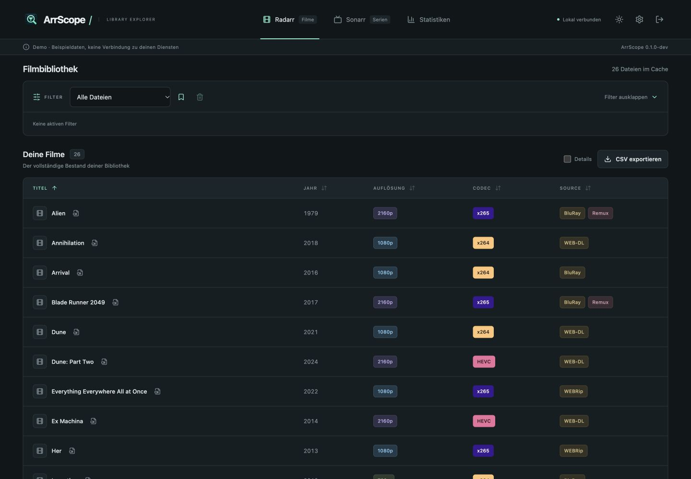

# ArrScope

Deine Radarr- und Sonarr-Bibliothek im Blick. Filtere vorhandene Mediendateien nach Auflösung, Encoder, Codec-Familie, Quelle, Jahr und weiteren Merkmalen – ohne Medien-Scan.



## Funktionen

- Getrennte Film- und Serienansichten, dunkles und helles Design, responsive Oberfläche auf Deutsch.
- Dateiname zuerst, API-Metadaten als Ergänzung; Herkunft und Widersprüche je Merkmal sichtbar. Mehrere Audio-Codecs und HDR-Profile erscheinen als einzelne Tags.
- Optional Emby: vorhandene Tonspurmetadaten ergänzen Sprache → Codec und Kanäle pro Spur. Eindeutige Emby-Tonspuren liefern präzisere Audio-/Sprachmerkmale als Dateiname oder zusammengefasste Arr-Angaben.
- `1080p UND x264`, mehrere Werte eines Filters mit ODER; Titel-/Dateisuche, Jahresbereich, Größe, HDR, Bit-Tiefe, Audio, Kanäle, Sprache und unbekannte Werte.
- `4K` wird zu `2160p`. `x264` bleibt von `AVC` unterscheidbar; zusätzlich gemeinsame Codec-Familie `H.264/AVC`.
- Serien nach Staffel gruppiert, Specials und Mehrfachepisoden unterstützt. Wahlweise nur Treffer oder ganze passende Staffeln mit markierten Treffern.
- Klickbare Film-Tabellenüberschriften sortieren auf-/absteigend; Spalte und Richtung bleiben im Browser gespeichert. Standard: Titel aufsteigend.
- Dashboard mit Film-, Serien-, Episoden- und Dateianzahl sowie Diagrammen für Auflösungen, Codecs und Sources, gesamt oder je Dienst.
- Benannte Presets und CSV aller tatsächlichen Treffer, unabhängig von der Seite. Standard: 100 Dateien pro Seite.
- SQLite mit FTS5 und Indizes; atomarer Dienst-Sync erhält bei Fehlern den letzten vollständigen Bestand.
- Globale Sync-Warteschlange, zwischengespeicherte Filterwerte und Dashboard-Aggregate; Datenqualitätsfilter findet auch teilweise unbekannte Tonspuren.
- Ein lokales Admin-Konto, verschlüsselte API-Keys, geschützte Sitzungen und CSRF-Prüfung.
- Ein Container, ein Go-Prozess, kein Node-Laufzeitprozess, kein Medien-Mount, kein Docker-Socket.

## Installation

Für Unraid siehe [Unraid-Anleitung](docs/UNRAID.md), für andere Docker-Installationen:

```sh
cp .env.example .env
# ARRSCOPE_APPDATA, ARRSCOPE_PORT und UID/GID in .env anpassen
mkdir -p /lokaler/pool/appdata/arrscope
# Für UID/GID 99:100 (bei anderer UID/GID anpassen):
sudo chown 99:100 /lokaler/pool/appdata/arrscope
sudo chmod 700 /lokaler/pool/appdata/arrscope
docker compose pull
docker compose up -d
```

`compose.yaml` verwendet `ghcr.io/buffer379x/arrscope:stable`. Das Image ist erst nach dem ersten genehmigten Release verfügbar. Für einen lokalen Test vorher:

```sh
docker build -t arrscope:local .
docker run --rm -p 127.0.0.1:8080:8080 -v arrscope-test:/data arrscope:local
```

Öffne die Oberfläche an Port 8080. Der einmalige Einrichtungscode liegt im Appdata-Verzeichnis `setup-token`; für Docker lässt er sich mit `docker exec arrscope cat /data/setup-token` lesen. Gib ihn und dein neues Admin-Passwort direkt in der Oberfläche ein. Danach in den Einstellungen Dienstadresse und API-Key hinterlegen, Verbindung testen, Dienst aktivieren und speichern. Der erste Sync startet automatisch.

Verwendet wird je Dienst genau eine Instanz. URL-Unterpfade sind möglich, z. B. `http://radarr:7878/radarr`. Verwende die direkte Dienstadresse ohne `/api/v3`, Query oder Zugangsdaten in der URL. HTTPS-Zertifikate werden geprüft; Weiterleitungen werden nicht verfolgt. Das Sync-Intervall ist standardmäßig 60 Minuten; möglich sind 15, 30, 60, 360, 1440 Minuten oder nur manuell.

## Daten und Betrieb

Das persistente `/data` enthält `arrscope.db`, WAL-Dateien, `secret.key` und Datenbanksicherungen. Es muss auf einem lokalen Dateisystem liegen; kein SMB/NFS. Sichere den gesamten Appdata-Bestand einschließlich des Schlüssels. Die letzten drei konsistenten Datenbankkopien bleiben erhalten. Vor Schema-Migrationen erfolgt automatisch eine Sicherung. [Backup und Rollback](docs/OPERATIONS.md).

ArrScope liest ausschließlich die API-v3-Endpunkte `system/status`, `movie`, `moviefile`, `series`, `episode` und `episodefile` per GET. Es veranlasst keine Scans, Downloads, Umbenennungen oder Änderungen an Radarr/Sonarr. Die Dienste selbst können unabhängig andere Aufgaben ausführen. Ohne Datei im Dienst gibt es keinen Dateieintrag in ArrScope. Fehlende Angaben bleiben unbekannt. Sprachen beziehen sich auf explizite Dateinamenangaben beziehungsweise gemeldete Audio-Sprachen; keine Ableitung aus Titel oder Herkunft. Source und Verarbeitung wie Remux sind getrennt.

Die API sammelt keinen serverweiten Snapshot: Während eines Syncs können sich die Dienste ändern. Inkonsistente Zuordnungen führen zu einem Fehler und erhalten den bisherigen Cache. Ein erneuter Sync gleicht den Stand ab. Ein Wechsel der Serveradresse erhält den alten Cache bis zum nächsten vollständig erfolgreichen Sync.

Für LAN/VPN vorgesehen. Ein HTTPS-Reverse-Proxy kann ergänzt werden; dann `ARRSCOPE_HTTPS=true` setzen, damit Sitzungscookies ausschließlich über HTTPS übertragen werden. ArrScope vertraut keinen beliebigen Forwarded-Headern. Hinter einem Proxy gilt die Login-Begrenzung pro Proxy-Adresse.

## Entwicklung und Prüfung

Benötigt: Go gemäß `go.mod`, Node 24 und pnpm 11.25.0.

```sh
pnpm --dir web install --frozen-lockfile
pnpm --dir web test
pnpm --dir web build
pnpm --dir web audit --audit-level=moderate
go test -race ./...
go vet ./...
go build -o work/arrscope ./cmd/arrscope
ARRSCOPE_DATA_DIR=./work/appdata ./work/arrscope
```

Die Oberfläche wird aus `web/dist` eingebettet und muss vor dem Go-Build gebaut werden. Für eine ausdrücklich getrennte Vorschau mit synthetischen Daten:

```sh
ARRSCOPE_DEMO=true ARRSCOPE_DATA_DIR=./work/demo ./work/arrscope
```

Demo-Anmeldung: `demo` / `ArrScope-demo-2026`. Demo-Daten werden ausschließlich in einem neuen Demo-Bestand angelegt; echte Konten werden abgewiesen. Keine Dienstverbindungen im Demo-Modus. Nicht für die produktive Installation aktivieren.

```sh
GOMAXPROCS=2 ARRSCOPE_PERF=1 go test -run TestPerformance50K -count=1 -v ./internal/app
```

[Testbericht und Grenzen der Messung](docs/VALIDATION.md), [Architektur und HTTP-API](docs/ARCHITECTURE.md).

## Releases

Pull Requests und Änderungen an `main` führen Tests und einen Container-Smoke-Test aus. Der manuelle Workflow **Approved release** nimmt eine freigegebene Versionsnummer wie `0.1.0` entgegen. Er prüft erneut, baut `linux/amd64` und `linux/arm64`, prüft beide Images, erstellt Git-Tag und Release-Notizen und aktualisiert anschließend `stable`. Versions-Tags werden nicht überschrieben. Unraid-Updates werden vom Benutzer ausgelöst; kein automatischer Updater und kein Zugriff auf den Docker-Socket. [Veröffentlichung](docs/RELEASING.md).

Das PNG-Icon wurde für ArrScope generiert. Transparente Varianten in 1024, 256 und 64 Pixeln sowie PNG-/ICO-Favicon und Apple-Touch-Icon liegen in `web/public`. Das Icon erscheint in Kopfzeile und Anmeldung; die Favicon-Varianten sind im HTML eingebunden. UI-Icons: Lucide (ISC); Preact/Vite und weitere Abhängigkeiten behalten ihre eigenen Lizenzen.

Lizenz: [MIT](LICENSE).

## Dashboard, Filter, Spalten und Farben

Das Dashboard ist die Startseite nach der Anmeldung und steht im Menü vor Radarr und Sonarr.

Merkmalsfilter besitzen die Operatoren „ist“ und „ist nicht“. Mehrere positive Werte gelten mit ODER; bei „ist nicht“ darf keiner der ausgewählten Werte vorkommen. Verschiedene Eigenschaften werden mit UND verbunden. Beispiel: Auflösung ist 1080p, Codec ist x265, Source ist nicht BluRay und WEB-DL. Unbekannte Angaben bleiben bei Ausschlüssen enthalten, bis „Unbekannt“ ebenfalls ausgeschlossen wird. Bei Sprache, Audio und HDR werden die einzelnen Werte mehrteiliger Angaben berücksichtigt. Ausschlüsse erscheinen als `Source ≠ BluRay` in den aktiven Filter-Tags. Operatoren werden in Presets gespeichert und gelten identisch für Liste und CSV.

Für Audio, HDR und Sprache stehen zusätzlich „enthält alle“ (UND) und „enthält nicht alle“ (NICHT die vollständige Kombination) zur Verfügung. Bei HDR10 und Dolby Vision zeigt „enthält nicht alle“ Dateien, denen mindestens eine dieser **erkannten Angaben** fehlt; „enthält keines“ schließt beide vollständig aus. Unbekannte Angaben sind ebenfalls Treffer bei „enthält nicht alle“. Ein aktiver Kombinationsfilter erscheint als gemeinsames Tag; dessen Kreuz entfernt die ganze Auswahl dieses Merkmals. Die Einzelauswahl bleibt im Dropdown möglich. HDR-Profile aus Dateiname und vorhandenen API-Angaben ergänzen sich; DV alleine lässt ArrScope keinen HDR10-Fallback erfinden.

Emby ist optional und wird in den Einstellungen mit URL und API-Key aktiviert. ArrScope liest ausschließlich `GET /emby/System/Info` und paginierte `GET /emby/Items` mit vorhandenen MediaSources/MediaStreams. Der Key wird per `X-Emby-Token` übertragen und wie die Arr-Keys verschlüsselt gespeichert; Browserantworten enthalten nur den Hinweis auf einen gespeicherten Key. Die [Emby-API](https://dev.emby.media/reference/RestAPI/ItemsService/getItems.html) liefert einzelne Audio-Streams mit Sprache, Codec, Profil, Kanälen und Standardspur. Es werden keine Wiedergabe-, Probe-, Refresh- oder Scan-Aufrufe ausgeführt.

Die Zuordnung verwendet einen **eindeutigen vollständigen Dateinamen und dieselbe positive Byte-Größe**, auch wenn die Container unterschiedliche Medienpfade verwenden. Mehrfachversionen werden über ihre jeweilige MediaSource zugeordnet. Gleichnamige und gleich große Dateien an unterschiedlichen Pfaden, doppelte Arr-Dateien und widersprüchliche Tonspur-IDs werden als mehrdeutig markiert und nicht ergänzt. Fehlende Größe oder Streams bleiben sichtbar. Externe Audio- und Untertitelspuren zählen nicht als Tonspuren der Datei. Die Sprachspalte zeigt zum Beispiel `Deutsch · DTS` und `Englisch · AC-3`; der Dateidialog zeigt alle Spuren einschließlich Kanälen und Standardmarkierung. CSV ergänzt die Spalten „Tonspuren“ und „Emby-Zuordnung“.

Emby folgt dem Intervall des jeweiligen Radarr-/Sonarr-Syncs. Fehler oder ein während der Pagination geänderter Bestand behalten den letzten vollständigen Cache. Ohne Emby kann ArrScope mehrere Codec-/HDR-Tokens erkennen, aber keine verlässliche Zuordnung einer Sprache zu einem Audio-Codec herstellen. Fehlende Sprach-/Codec-Angaben in einer Emby-Spur bleiben „Unbekannt“. Filter zeigen erkannte Metadaten und garantieren nicht die physische Abwesenheit eines nicht gemeldeten Merkmals.

Der Filterbereich zeigt ausgeklappt alle Filtermöglichkeiten und lässt sich vollständig einklappen; aktive Filter und das Preset-Dropdown bleiben zugänglich. Das Lesezeichen speichert eine benannte Filterkombination dauerhaft in SQLite, getrennt für Filme und Serien. Gespeicherte Presets bleiben nach Abmeldung, Browser- und Container-Neustart erhalten, bis sie mit dem Papierkorb gelöscht werden. Eine geänderte Kombination zeigt „Eigene Filter“.

Unter Einstellungen → Standardspalten wählst du getrennt für Radarr und Sonarr die sichtbaren Spalten aus. Die Pfeile bestimmen die Reihenfolge von links nach rechts, einschließlich ausgeblendeter Spalten. Titel beziehungsweise Episode bleibt sichtbar, kann aber ebenfalls verschoben werden. Die Auswahl wird in SQLite gespeichert und bleibt nach Browser- und Container-Neustarts erhalten. „Standard wiederherstellen“ setzt Auswahl und Reihenfolge des jeweiligen Dienstes zurück: sichtbar sind Titel/Episode, Jahr, Auflösung, Codec und Source. „Alle Spalten“ neben dem CSV-Export zeigt vorübergehend sämtliche Spalten in dieser Reihenfolge; „Standardansicht“ kehrt zur gespeicherten Auswahl zurück. Dieser Schalter gilt getrennt je Bibliothek für die aktuelle Sitzung. Die Spaltenauswahl verändert weder Filtermöglichkeiten noch den vollständigen CSV-Export.

Unter Einstellungen → Tag-Farben lassen sich bereits erkannte Auflösungen, Codecs, Sources, Verarbeitungsarten, HDR-Formate und Audio-Codecs einzeln einfärben. Die Farben gelten in beiden Bibliotheken und Designs. „Standard“ entfernt die jeweilige eigene Farbe; „Einstellungen speichern“ übernimmt die Änderungen dauerhaft. Im hellen Design erhalten auch Standard-Tags kräftigere farbige Hintergründe.


Die Einstellungen sind in **Verbindungen**, **Darstellung** und **Wartung** unterteilt. Gespeicherte API-Keys können ausdrücklich entfernt werden. Emby unterstützt optionale absolute Pfadzuordnungen als zusätzliche Identitätsprüfung. Mehrsprachigkeit wird als Menge normalisiert; zusätzliche API-Sprachen ergänzen erkannte Dateinamen-Sprachen. Der Filter **Metadaten-Vollständigkeit** und Dashboard-Widgets machen fehlende Tonspurangaben und Emby-Zuordnungen sichtbar.

Die Korrekturen, Regressionstests und aktuellen Container-Messungen stehen im [Korrekturbericht](docs/REVIEW-FIXES.md). Für einen isolierten Lasttest mit ausschließlich synthetischen Arr-/Emby-Diensten: `python3 docs/scripts/containercheck.py --image arrscope:local`. Der Test legt nur seinen eigenen temporären Container und Datenbestand an; er benötigt Docker und verwendet kein bestehendes ArrScope-Appdata.
